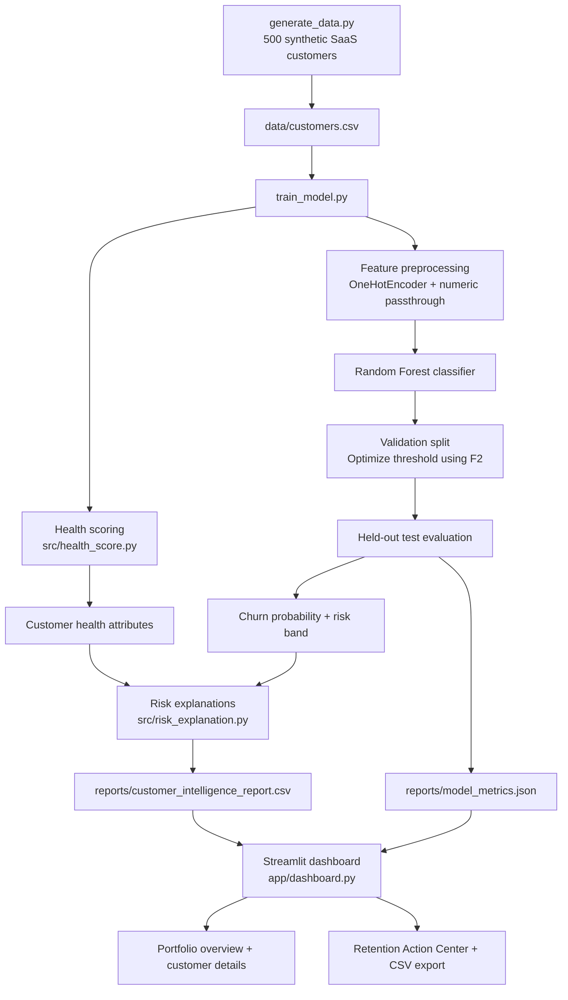

# CustomerSuccess AI
### Customer Health, Churn Risk & Retention Intelligence

[](https://customersuccessai-ewr74djgmwxec25smnv3ay.streamlit.app/)
[](https://www.python.org/)
[](https://scikit-learn.org/)

**CustomerSuccess AI** is a portfolio project that demonstrates how customer success teams can bring customer engagement signals, product usage, support experience and renewal timelines into one customer intelligence dashboard.

It combines a Random Forest churn-classification workflow with rule-based customer health scoring, explainable risk indicators and a prioritized retention action center. The project uses a reproducible synthetic SaaS dataset and runs without paid API keys or external LLM services.

> **Important:** All 500 customer records are synthetic. The churn labels are generated from heuristic rules in `generate_data.py`. The reported model metrics are a learning/demo evaluation on this generated dataset, not evidence of real-world predictive performance. Do not use this model for live customer or revenue decisions.

**Explore the live app:** [CustomerSuccess AI Dashboard](https://customersuccessai-ewr74djgmwxec25smnv3ay.streamlit.app/)  
**Source code:** [GitHub Repository](https://github.com/srikanthps1613-commits/CustomerSuccessAI)

---


## Dashboard screenshots

The following screenshots are captured from the deployed Streamlit application. They show the actual portfolio dashboard and customer-level views.

### Portfolio overview and model evaluation


### Customer retention action center


### Customer risk indicators and recommended CSM actions


### Customer health score factors


## What it does

### 1. Customer health scoring
Calculates a score from 0–100 using:
- Product login activity and usage trend
- Feature adoption
- Unresolved support tickets
- Customer satisfaction (CSAT) and NPS
- Recency of Customer Success Manager (CSM) engagement

Health categories:
- **Healthy:** 80–100
- **Needs Attention:** 60–79
- **At Risk:** 0–59

The score is a transparent, rule-based indicator, not a learned probability.

### 2. Churn probability and risk bands
- Trains a scikit-learn Random Forest classifier.
- One-hot encodes categorical features and passes numeric features through.
- Uses stratified training, validation and held-out test splits.
- Selects a classification threshold on the validation set by maximizing F2.
- Reports accuracy, precision, recall, F1, F2, ROC-AUC, average precision, confusion matrix and classification report.
- Displays probability-based business risk bands: High Risk (70%+), Medium Risk (40–69.9%), and Low Risk (below 40%).

The probability bands are separate from the validation-optimized classification threshold.

### 3. Risk explanations and recommended actions
Uses explicit business rules to surface signals such as falling usage, low logins, unresolved tickets, low CSAT, stale CSM engagement and approaching renewals. Each signal can map to a suggested CSM follow-up.

### 4. Customer portfolio dashboard
The Streamlit dashboard includes:
- Portfolio KPIs and MRR summaries
- Churn-risk and customer-health distributions
- Filters for churn risk, subscription plan and industry
- Customer-level account and product-engagement details
- Model evaluation metrics and confusion matrix

### 5. Retention Action Center
- Assigns rule-based CSM follow-up priorities: Critical, High, Medium or Monitor.
- Considers churn-risk band and days to renewal.
- Estimates revenue exposure as monthly recurring revenue multiplied by model-estimated churn probability.
- Provides a downloadable CSV of prioritized follow-ups.

**Revenue exposure is an illustrative estimate, not actual or guaranteed lost revenue.** Priorities are recommendations for human review; the app does not contact customers or automate outreach.

---

## Architecture

The project has two main stages:

1. **Offline intelligence pipeline:** generate data, calculate health scores, train/evaluate the churn model, create explanations and write report artifacts.
2. **Dashboard stage:** Streamlit reads the generated customer report and model metrics and presents portfolio, customer and retention views.



See [docs/architecture.md](docs/architecture.md) for the standalone architecture diagram and component notes.

---

## Model evaluation: current committed run

The repository's current `reports/model_metrics.json` records the following held-out test results:

| Metric | Result |
|---|---:|
| Training records | 300 |
| Validation records | 100 |
| Test records | 100 |
| Accuracy | 32.0% |
| Precision | 32.0% |
| Recall | 100.0% |
| F1 score | 48.5% |
| F2 score | 70.2% |
| ROC-AUC | 0.625 |
| Average precision | 0.450 |

The confusion matrix for this run is:

|  | Predicted retained | Predicted churn |
|---|---:|---:|
| Actual retained | 0 | 68 |
| Actual churn | 0 | 32 |

**How to interpret this:** the F2-oriented threshold selected on validation predicts every test record as churn in this particular run. It catches all churn-labelled test records (100% recall) but also flags all retained records (32% precision, 32% accuracy). This is an important limitation, not a production-ready result. It shows why threshold selection must be assessed alongside the confusion matrix and business cost of false positives.

Because the dataset is synthetic and the labels are generated from heuristics using similar signals, these metrics should be treated as a demonstration of the workflow only. A meaningful real-world evaluation requires representative historical customer data, time-aware validation, leakage checks, calibration and ongoing monitoring.

---

## Project structure

```text
CustomerSuccessAI/
├── app/
│   └── dashboard.py
├── data/
│   └── customers.csv
├── models/
│   ├── churn_model.pkl
│   └── decision_threshold.pkl
├── reports/
│   ├── customer_intelligence_report.csv
│   └── model_metrics.json
├── src/
│   ├── __init__.py
│   ├── churn_prediction.py
│   ├── health_score.py
│   └── risk_explanation.py
├── docs/
│   └── architecture.md
├── generate_data.py
├── train_model.py
├── requirements.txt
└── .gitignore
```

---

## Run locally

The project was developed as a beginner-friendly Python portfolio project. Python 3.12 is a sensible environment choice for broad package compatibility.

### 1. Clone the repository

```bash
git clone https://github.com/srikanthps1613-commits/CustomerSuccessAI.git
cd CustomerSuccessAI
```

### 2. Create and activate a virtual environment

**Windows PowerShell:**

```powershell
py -3.12 -m venv .venv
.venv\Scripts\Activate.ps1
```

If PowerShell blocks activation, use Command Prompt:

```bat
.venv\Scripts\activate.bat
```

### 3. Install dependencies

```bash
python -m pip install --upgrade pip
pip install -r requirements.txt
```

### 4. Generate the synthetic dataset

```bash
python generate_data.py
```

### 5. Train the model and generate reports

```bash
python train_model.py
```

This creates or updates:
- `models/churn_model.pkl`
- `models/decision_threshold.pkl`
- `reports/customer_intelligence_report.csv`
- `reports/model_metrics.json`

### 6. Launch the dashboard

```bash
streamlit run app/dashboard.py
```

The dashboard reads the generated CSV report and JSON metrics. If you only want to open the dashboard from the committed repository, the generated report and metrics are already included; model retraining is not required to view them.

---

## Technology stack

- **Python** — application and data pipeline
- **Pandas / NumPy** — data preparation and calculations
- **scikit-learn** — preprocessing, Random Forest and evaluation
- **Streamlit** — interactive dashboard
- **Plotly** — data visualizations
- **Joblib** — model and threshold persistence

No paid API key, hosted LLM, or external AI service is required.

---

## Limitations and responsible use

- Synthetic records and heuristic-generated labels do not represent real customer behaviour.
- The current evaluation has a high false-positive rate at the selected threshold; inspect the confusion matrix, not only the F2 score.
- The health score and CSM priorities are transparent rules chosen for demonstration. They are not statistically validated business policies.
- Revenue exposure is a probability-weighted illustration, not a revenue forecast.
- The dashboard is an analytics prototype. It does not integrate with a CRM, billing system or product telemetry platform, and it does not send customer communications.
- Before any real deployment, use authorized data, review privacy and access controls, validate on time-separated real outcomes, calibrate probabilities, define business costs and monitor model drift.

---

## Possible next improvements

- Evaluate alternative thresholds against explicit false-positive and false-negative costs.
- Add time-based train/test splits and probability calibration.
- Add model explainability and feature-level diagnostics.
- Connect validated customer data from a CRM or product analytics source.
- Add authentication, role-based access and audit logging.
- Track CSM action outcomes to measure whether interventions improve retention.

---

## Project links

- **Live dashboard:** https://customersuccessai-ewr74djgmwxec25smnv3ay.streamlit.app/
- **GitHub repository:** https://github.com/srikanthps1613-commits/CustomerSuccessAI

Built as a hands-on portfolio project exploring customer success analytics, churn modelling, explainable risk signals and retention prioritization.
