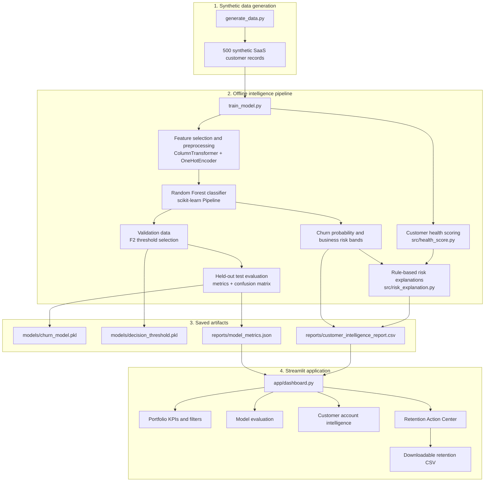

# CustomerSuccess AI — Architecture

This document describes the data flow and main components of the CustomerSuccess AI portfolio project.

## End-to-end architecture

## Component responsibilities

| Component | Responsibility |
|---|---|
| `generate_data.py` | Creates 500 reproducible synthetic SaaS customer records and heuristic churn labels. |
| `src/health_score.py` | Calculates a transparent 0–100 customer health score and health status from engagement and support signals. |
| `src/churn_prediction.py` | Preprocesses categorical/numeric features, trains the Random Forest pipeline, selects a threshold on validation data and evaluates on held-out test data. |
| `src/risk_explanation.py` | Converts selected customer signals into readable risk reasons and suggested CSM actions using explicit rules. |
| `train_model.py` | Orchestrates the pipeline and writes model, threshold, customer report and evaluation artifacts. |
| `app/dashboard.py` | Loads the saved report and metrics and renders portfolio analytics, customer detail and retention prioritization. |

## Data and decision flow

1. `generate_data.py` writes `data/customers.csv`.
2. `train_model.py` loads the data and calculates customer health scores.
3. The model uses a stratified 60% training / 20% validation / 20% test split.
4. Categorical fields are one-hot encoded; numeric fields pass through the preprocessing pipeline.
5. A Random Forest classifier is trained on the training split.
6. The validation split is used to select a classification threshold that maximizes F2. The held-out test split is used for the reported final metrics.
7. The pipeline calculates churn probabilities and assigns separate business risk bands: High Risk at 70% or above, Medium Risk from 40% to below 70%, and Low Risk below 40%.
8. Rule-based logic generates risk explanations and recommended CSM actions.
9. The pipeline saves the customer report and model metrics. The Streamlit app reads the report and metrics; it does not retrain the model when a visitor opens the dashboard.
10. The Retention Action Center assigns a rule-based CSM priority and estimates revenue exposure as MRR multiplied by churn probability. It exports the filtered action list as CSV.

## Important implementation notes

- The churn classification threshold selected for `predicted_churn` is not the same as the dashboard's fixed probability-based risk bands.
- The dashboard's retention priority is a separate rule-based business recommendation.
- The committed synthetic dataset and generated report are included so the deployed dashboard can render without a visitor training the model.
- The current threshold optimization can produce an undesirable operating point. In the committed evaluation, all test records were classified as churn. This is explicitly documented in the README and should be addressed before considering real-world use.
- No CRM write-back, automatic outreach, or customer notification is implemented.
